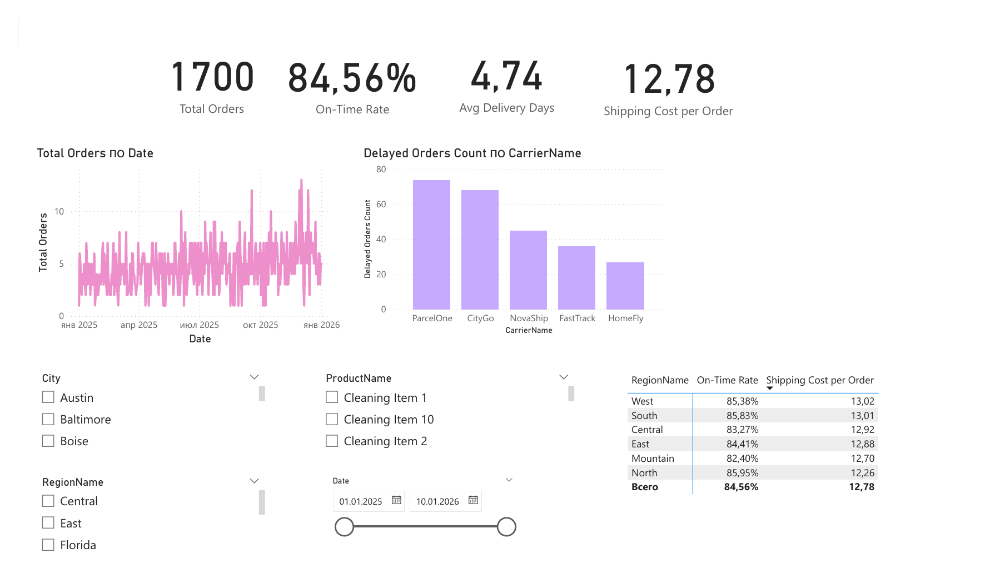
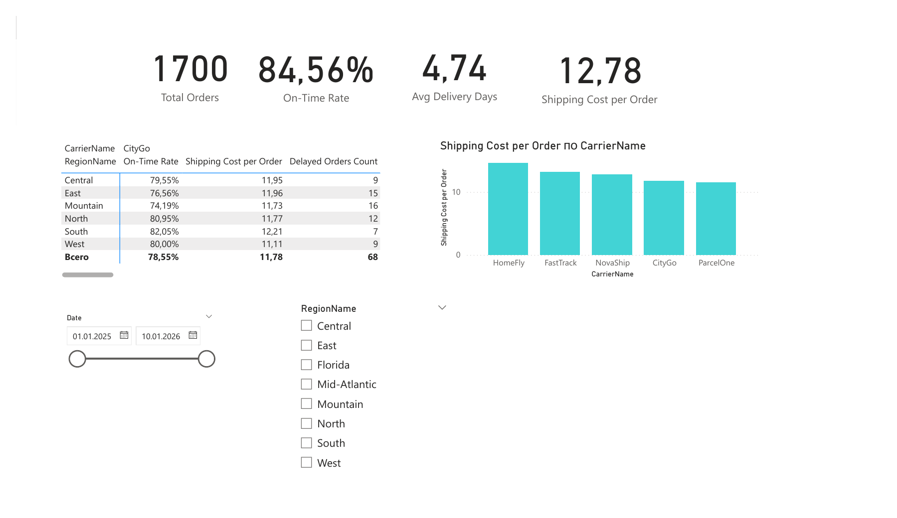
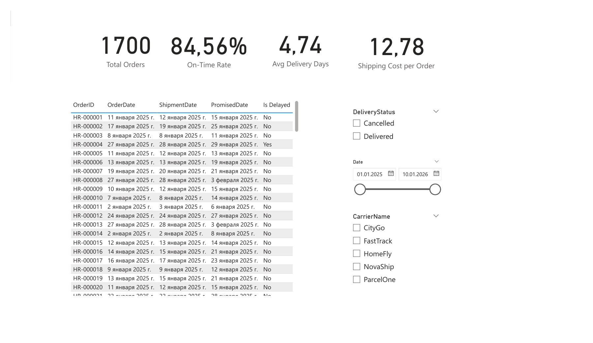

# HomeRoute | Delivery & Logistics Analytics in Power BI

**End-to-end business intelligence case study · Power BI · DAX · Power Query (M)**  
**Author:** Ksenia Samokhina  
**Language:** English | [Русская версия](README_RU.md)

## Project Overview

HomeRoute is a fictional household-goods delivery company serving retail customers through regional warehouses and third-party carriers. Operations managers need a clear view of delivery reliability, transit time, shipping expenditure, and performance differences across carriers and regions.

I developed a three-page Power BI report to turn order and shipment records into actionable operational metrics and interactive drill-downs. The project is based on the HomeRoute BI case study.

## Business Questions

- How many orders are processed, and what share of completed deliveries arrive on time?
- How long does delivery take on average, and what is the average shipping cost per order?
- Which carriers account for the most delayed deliveries, and how do shipping costs compare?
- How does delivery reliability vary by region?
- Which specific shipments require closer investigation?

## Data & Model

The supplied source files represent a relational logistics dataset. The following source tables were inspected:

| Table | Records | Role |
|---|---:|---|
| `Orders` | 1,700 | Order dates, customers, warehouses, regions, shipping classes |
| `OrderLines` | 3,352 | Ordered products, quantities, unit prices |
| `Customers` | 720 | Customer segments, cities, regions |
| `Products` | 50 | Product names, categories, prices |
| `Categories` | 5 | Product categories |
| `Carriers` | 5 | Delivery service providers |
| `Warehouses` | 6 | Fulfillment locations |
| `Regions` | 8 | Regional reference data |
| `Calendar` | 375 | Dates from January 1, 2025, to January 10, 2026 |
| `Shipments` (13 monthly files) | 1,700 | Shipping, promised and actual delivery dates, costs, status |

## Key KPIs

| KPI | Overall dashboard result |
|---|---:|
| Total Orders | **1,700** |
| On-Time Delivery Rate | **84.56%** |
| Average Delivery Time | **4.74 days** |
| Shipping Cost per Order | **12.78** |
| Completed Deliveries | **1,619** |
| Cancelled Shipments | **81** |
| Delayed Completed Deliveries | **250** |

## Findings & Business Interpretation

**Delivery reliability.** An 84.56% on-time delivery rate means that late delivery is a material service-quality issue worth monitoring. The rate is based on completed deliveries according to the DAX measure.

**Regional differences.** In the overall regional table, the highest visible on-time rate is **North (85.95%)**, while the lowest is **Mountain (82.40%)**. This suggests prioritizing investigation of the weaker-performing regions, rather than assuming every region faces the same challenges.

**Carrier performance.** The dashboard compares the *number* of delayed deliveries by carrier. Absolute delay counts should not be confused with carrier delay *rates*: a high-volume carrier may have more late shipments without being proportionally less reliable.

**Cost versus service.** Shipping cost per order varies across carriers. Carrier selection should consider both cost and delivery reliability, rather than optimizing either metric alone.

**Filtered-view caveat.** The CityGo view shows a **74.19%** on-time rate for Mountain and **82.05%** for South. These are carrier-filtered results and should not replace the overall regional metrics above.

## Implementation

- **Power BI:** three report pages with KPI cards, time trends, carrier comparisons, regional performance tables and shipment-level records.
- **DAX:** calculations for total orders, completed deliveries, on-time delivery rate, average delivery days, shipping cost per order, delayed delivery count and a delay flag.
- **Power Query (M):** folder-based import of monthly shipment files, file combination, type conversion, normalization of shipping-cost decimals and duplicate removal.
- **Interactive analysis:** slicers and filters for date, region, city, product, carrier and delivery status across relevant report pages.

## Tools & Skills

`Power BI Desktop` · `DAX` · `Power Query (M)` · `Data Modeling` · `Data Cleaning` · `KPI Design` · `Interactive Dashboards` · `Logistics Analytics`

## How to Explore

1. Open `HomeRoute_Delivery_Analytics.pbix` with **Power BI Desktop** to explore the interactive report.
2. Alternatively, view `Dashboards.pdf` or the three screenshots below.
3. Explore the DAX measures and Power Query transformation code using the links below.

**Portfolio focus:** translating logistics operations data into clear management KPIs, interactive reporting and evidence-based operational questions.

## Dashboard Screenshots

### 1. Delivery Performance Overview

A consolidated view of order volume, delivery timeliness, average delivery days, shipping cost per order, delayed orders by carrier, and regional performance.

### 2. Carrier & Regional Analysis

Carrier-focused comparison of shipping costs and on-time delivery by region, with interactive filtering. The screenshot shows a **CityGo-filtered** regional view; its figures must not be interpreted as company-wide regional rates.

### 3. Shipment-Level Details

A detailed table for investigating individual deliveries, with filters for delivery status, carrier and date.

## Quick Links

- **[Power BI report (.pbix)](HomeRoute_Delivery_Analytics.pbix)** — interactive report for Power BI Desktop.
- **[DAX measures](code/measures.dax)** — KPI calculations and delay logic.
- **[Power Query (M)](code/power_query_shipments.m)** — shipment import and data preparation.
- **[Dashboard PDF](Dashboards.pdf)** — all three report pages in one document.
- **[Russian README](README_RU.md)** — project description in Russian.
